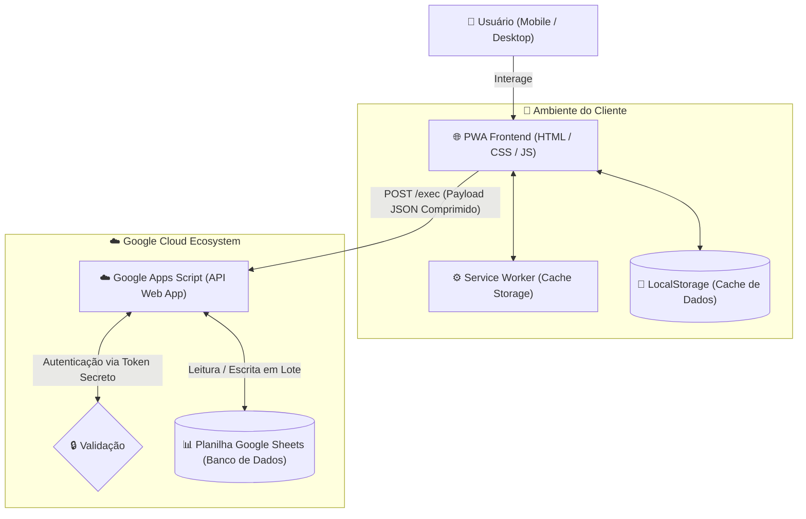

# 💰 ID Finanças — Meu Controle Financeiro (PWA)

[](https://idfinancas.vercel.app/)
[](https://developer.mozilla.org/pt-BR/docs/Web/Progressive_web_apps)
[](https://developer.mozilla.org/pt-BR/docs/Web/JavaScript)
[](https://developers.google.com/apps-script)
[](https://github.com/ivanildodias/controle-financeiro-pwa)
[](#licença)

> 🚀 **App Oficial Online:** [https://idfinancas.vercel.app/](https://idfinancas.vercel.app/)  
> 📦 **Repositório GitHub:** [https://github.com/ivanildodias/controle-financeiro-pwa](https://github.com/ivanildodias/controle-financeiro-pwa)

Um **Progressive Web App (PWA)** moderno, leve e completo para **gestão financeira pessoal e controle de fluxo de caixa**, projetado com foco em usabilidade móvel (*mobile-first*), alta performance e **zero dependências externas**.

O aplicativo utiliza uma arquitetura *Headless/Serverless*, operando como uma Single Page Application (SPA) que se conecta à sua própria planilha do **Google Sheets** via **Google Apps Script**, servindo como banco de dados relacional gratuito, privado e 100% sob seu controle.

---

## 📌 Sumário
- [Recursos e Destaques](#-recursos-e-destaques)
- [Arquitetura do Sistema](#-arquitetura-do-sistema)
- [Módulos da Aplicação](#-módulos-da-aplicação)
- [Estrutura do Projeto](#-estrutura-do-projeto)
- [Como Configurar e Executar](#-como-configurar-e-executar)
- [Tecnologias Utilizadas](#-tecnologias-utilizadas)
- [Licença e Créditos](#-licença-e-créditos)

---

## ✨ Recursos e Destaques

* 📱 **PWA Instalável e Offline-First**:
  * Funciona como aplicativo nativo no Android, iOS, Windows e macOS.
  * **Service Worker com Cache Storage** para carregar a casca da aplicação mesmo sem conexão à internet.
  * **Estratégia Stale-While-Revalidate (SWR)**: Carregamento instantâneo via `localStorage` com sincronização silenciosa em segundo plano.
  * Sensor de rede automático com indicador de status off-line.

* ⚡ **Interface Otimista (Optimistic UI)**:
  * Resposta instantânea ao criar, editar ou gerar parcelas: o modal fecha na hora e os dados atualizam na tela sem esperar o tempo de resposta da rede.
  * Rede de segurança com mecanismo de **Rollback automático** caso a conexão falhe.

* 💳 **Gestão Completa de Cartões e Faturas**:
  * Controle de limites totais e disponíveis por cartão.
  * Cálculo dinâmico de status da fatura: **Aberta**, **Fechada**, **Paga**, **Atrasada** ou **Futura**.
  * Determinação automática da data de pagamento baseada no dia de **Fechamento** e **Vencimento** do cartão cadastrado.
  * **Parcelamento Automático**: Divide o valor em até 120x, ajustando os centavos de resto na primeira parcela e projetando os vencimentos futuros.

* ⏳ **Gaveta de Lançamentos Futuros**:
  * Separação inteligente: compras realizadas hoje cujo vencimento cai em meses posteriores são isoladas numa gaveta retrátil especial, não poluindo o fluxo de caixa do mês vigente.

* 🗂️ **Ações em Lote**:
  * Seleção múltipla rápida ou via **toque longo com vibração háptica** no celular.
  * Exclusão e edição em lote (alteração em massa de categoria, conta, datas ou status).

* 🎨 **Design System & Acessibilidade**:
  * **Modo Escuro (Dark Mode)** e Modo Claro nativos.
  * 5 paletas de cores de destaque selecionáveis: *Azul Padrão*, *Verde Esmeralda*, *Roxo Ametista*, *Laranja Outono* e *Vermelho Rubi*.
  * Controle de densidade de texto (Modo Compacto vs. Ampliado).
  * Gráficos interativos (Donut SVG e Barras de Fluxo) construídos **sem bibliotecas externas pesadas**.

* 🔍 **Filtros e Busca Avançada**:
  * Omnibox de pesquisa global instantânea.
  * Multi-seleção com campo de tags interativo (estilo Notion).
  * Base temporal intercambiável por **Data de Compra** ou **Data de Pagamento**.

* 🛡️ **Auditoria de Integridade**:
  * Módulo dedicado que varre a base de lançamentos identificando contas ou categorias antigas não cadastradas formalmente no sistema.

---

## 🏛️ Arquitetura do Sistema



### Otimização de Payload (Compressão de Matriz)
Para garantir máxima velocidade mesmo em redes móveis 3G/4G, a API do Google Apps Script não trafega arrays de objetos JSON redundantes. Em vez disso, envia matrizes leves no formato:
```json
{
  "colunas": ["id", "data_compra", "descricao", "valor", "categoria", "conta"],
  "registros": [
    ["L1001", "2026-10-22", "Supermercado", -150.50, "Alimentação", "Nubank"],
    ["L1002", "2026-10-22", "Salário", 5000.00, "Receitas", "Itaú"]
  ]
}
```
O cliente realiza a descompressão instantânea em memória RAM, economizando largura de banda e tempo de CPU.

---

## 🖥️ Módulos da Aplicação

### 1. Painel Geral (Dashboard)
* **Cards de Resumo**: Total de Receitas, Despesas, Balanço, Saldo em Caixa/Conta Corrente e Investimentos, com comparação direta entre valor **Efetivo** (já consolidado) e **Projetado** (previsto até o fechamento do período).
* **Fluxo de Caixa Diário / Mensal**: Barras gráficas customizadas com tooltips detalhados.
* **Alertas e Previsões**: Notificações automáticas de faturas próximas de vencer e despesas do dia.
* **Posição Patrimonial**: Carrossel visual com saldos por instituição financeira.
* **Uso de Crédito**: Visão detalhada de faturas ativas e comprometimento do limite.
* **Visão Anual Pivot**: Matriz dinâmica anual de despesas cruzadas com categorias.

### 2. Histórico de Lançamentos
* Tabela de alta densidade no Desktop e lista de Cards interativos no Mobile.
* Resumo dinâmico no topo com saldo filtrado e alternância para somar ou desconsiderar faturas de crédito.
* Modal de lançamento com suporte a:
  * Receitas, Despesas e **Transferências entre contas**.
  * Modelos rápidos pré-configurados.
  * Parcelamento automático no crédito.

### 3. Configurações e Sistema
* **Contas & Cartões**: Definição de tipo, limites, cor identificadora, fechamento e vencimento.
* **Categorias**: Organização por grupos financeiros e seletor com mais de 50 ícones visuais (*Material Icons*).
* **Modelos Rápidos**: Criação de atalhos para lançamentos recorrentes (aluguel, salário, assinaturas).
* **Importador em Lote**: Importação rápida via texto separado por ponto e vírgula (CSV) para reconciliação bancária rápida.
* **Auditoria**: Detecção de inconsistências cadastrais na base histórica.

---

## 📂 Estrutura do Projeto

```
controle-financeiro-pwa/
├── backend/
│   └── codigo.gs     # API Headless no Google Apps Script e inicializador da planilha
├── index.html        # Estrutura semântica, modais, formulários e layouts SPA
├── style.css         # Design tokens, temas claro/escuro, utilitários e responsividade
├── script.js         # Núcleo reativo: cálculos contábeis, filtros, ordenação e API
├── sw.js             # Service Worker: ciclo de vida do cache offline
├── manifest.json     # Metadados de instalação do PWA
├── favicon.png       # Ícone do aplicativo
└── README.md         # Documentação técnica do projeto
```

---

## 🚀 Como Começar a Usar

Você **não precisa instalar nada no seu computador** para começar a usar o ID Finanças! O frontend já está publicado e pronto para uso na Vercel: **[https://idfinancas.vercel.app/](https://idfinancas.vercel.app/)**.

Basta configurar o seu próprio banco de dados no Google Sheets seguindo os passos abaixo:

### Passo 1: Configurar a Planilha e o Backend (Google Apps Script)
1. Crie uma nova planilha em branco no [Google Sheets](https://sheets.new).
2. Na planilha, acesse o menu superior **Extensões** ➔ **Apps Script**.
3. Apague qualquer código existente no editor e cole todo o conteúdo do arquivo [`backend/codigo.gs`](backend/codigo.gs).
4. **Gerando a Estrutura da Planilha Automaticamente**:
   * No menu superior do Apps Script, selecione a função **`inicializarBancoDeDados`** no seletor de funções e clique em **Executar**.
   * O Google solicitará permissão na primeira execução (clique em *Avançado* ➔ *Acessar projeto (não seguro)* para autorizar o script a manipular a sua planilha).
   * O script criará automaticamente:
     * A aba **Lançamentos** com cabeçalhos estilizados, checkboxes e formatação de datas e moedas;
     * A aba **Config** com tabelas de Contas, Categorias e Modelos Rápidos já preenchidos com dados padrão essenciais;
     * Um menu personalizado **"⚙️ ID Finanças"** direto na sua planilha para manutenções futuras.
5. **Definindo sua Senha de Acesso (Token Secreto)**:
   * Volte para a aba **Config** na planilha.
   * Na célula **V2** (abaixo de *Token_API* em **V1**), o script definirá a senha padrão `123456`.
   * Você pode manter essa senha ou alterá-la para o código/senha que preferir.
6. **Implantando a API (Web App)**:
   * No editor do Apps Script, clique no botão azul **Implantar** ➔ **Nova implantação**.
   * Clique na engrenagem ao lado de "Selecione o tipo" e escolha **Aplicativo da Web**.
   * Preencha:
     * **Descrição**: `API ID Finanças`
     * **Executar como**: *Eu (seu e-mail)*
     * **Quem tem acesso**: *Qualquer pessoa* (imprescindível para que o frontend se comunique com a planilha; a segurança dos seus dados é garantida pelo Token Secreto).
   * Clique em **Implantar** e copie a **URL do Aplicativo da Web** gerada (terminada em `/exec`).

### Passo 2: Conectar no Aplicativo Online
1. Acesse o aplicativo: **[https://idfinancas.vercel.app/](https://idfinancas.vercel.app/)**
2. Na tela de **Acesso Restrito**, insira:
   * **URL do Web App (Google)**: Cole a URL copiada do passo anterior (`https://script.google.com/macros/s/.../exec`).
   * **Token Secreto da Planilha**: A senha que está na célula `V2` da sua planilha (padrão: `123456`).
3. Clique em **Desbloquear Sistema**.
4. Pronto! O app sincronizará imediatamente todas as contas, categorias e relatórios. Você já pode instalar o PWA no seu celular ou desktop!

---

### Executando o Frontend Localmente (Opcional para Desenvolvedores)
Caso queira clonar o repositório e rodar o projeto localmente:

1. Clone o repositório:
   ```bash
   git clone https://github.com/ivanildodias/controle-financeiro-pwa.git
   cd controle-financeiro-pwa
   ```
2. Inicie um servidor local HTTP (necessário para que o Service Worker do PWA funcione):
   * **Opção A (VS Code)**: Instale a extensão **Live Server**, clique com botão direito em `index.html` e escolha *"Open with Live Server"*.
   * **Opção B (Python)**:
     ```bash
     python3 -m http.server 8080
     ```
3. Abra `http://localhost:8080` ou `http://127.0.0.1:5500` no seu navegador.

---

## 🛠️ Tecnologias Utilizadas

* **Linguagem Principal**: JavaScript puro (ES6+) sem transpilação ou dependências de build (*No Node.js, No Webpack*).
* **Interface & Estilos**: HTML5 Semântico e CSS3 puro utilizando Variáveis Customizadas (*CSS Variables*), Flexbox, CSS Grid e media queries para design responsivo.
* **Tipografia e Ícones**: Google Fonts & Google Material Icons.
* **PWA**: Web App Manifest e Service Worker com Cache API.
* **Banco de Dados & API**: Google Sheets + Google Apps Script (POST Webhooks / RPC).

---

## 📄 Licença

Distribuído sob a licença **MIT**. Consulte o arquivo de licença para mais detalhes.

---

Desenvolvido com foco em produtividade, simplicidade e controle total sobre suas finanças pessoais. Se este projeto te ajudou, deixe uma ⭐ no repositório!

